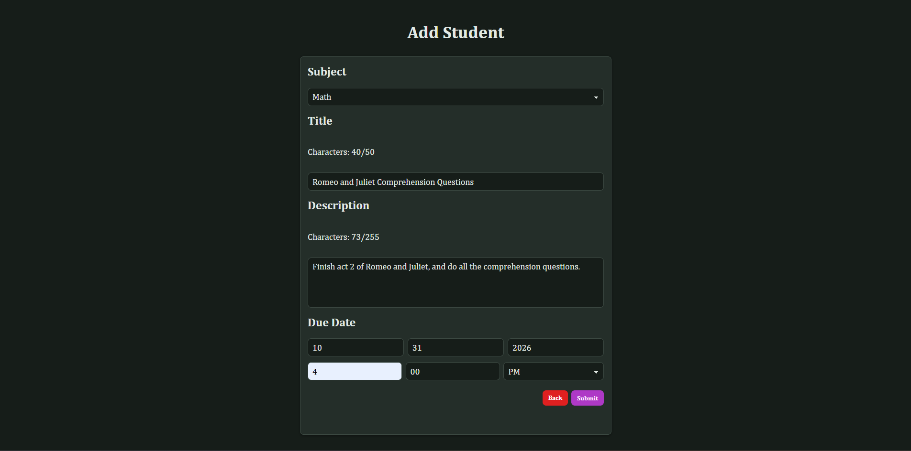
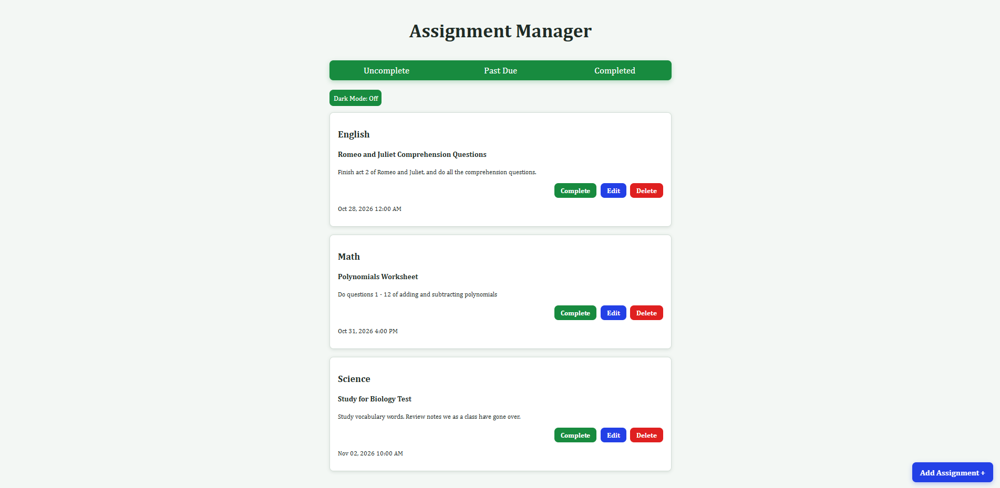

# Assignment Manager

A full-stack web application that allows students to track assignments, and manage deadlines.

## Features
  - Create assignments
  - Edit assignments
  - View assignment dashboard
  - Delete assignments
  - Mark assignments complete
  - View overdue assignments

## Technologies Used
  - Python
  - Flask
  - HTML/CSS
  - JavaScript
  - SQLite

## Future Improvements
  - Email reminders
  - Calendar view
  - Priority levels

## Screenshots

Change Themes

