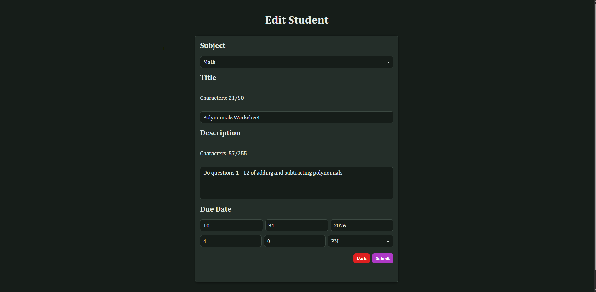
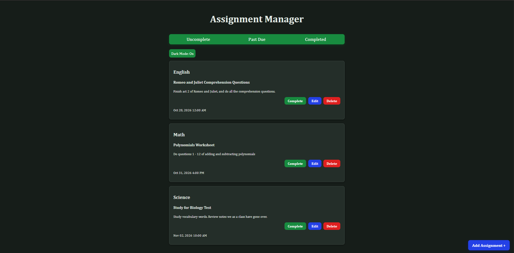
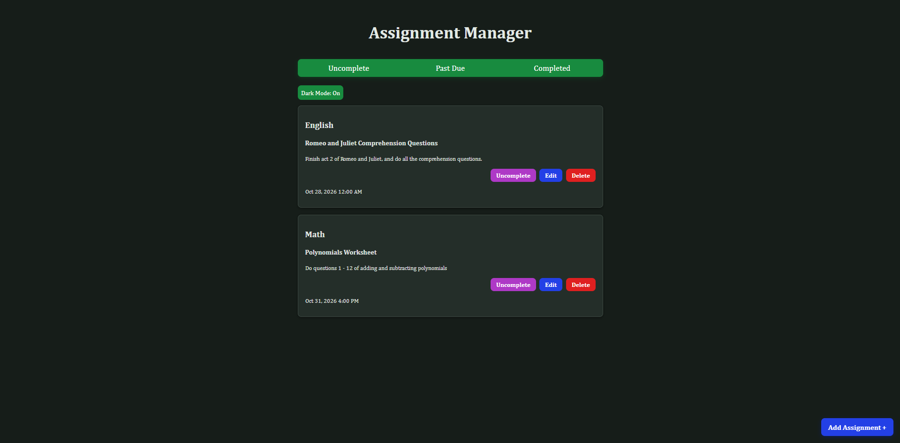
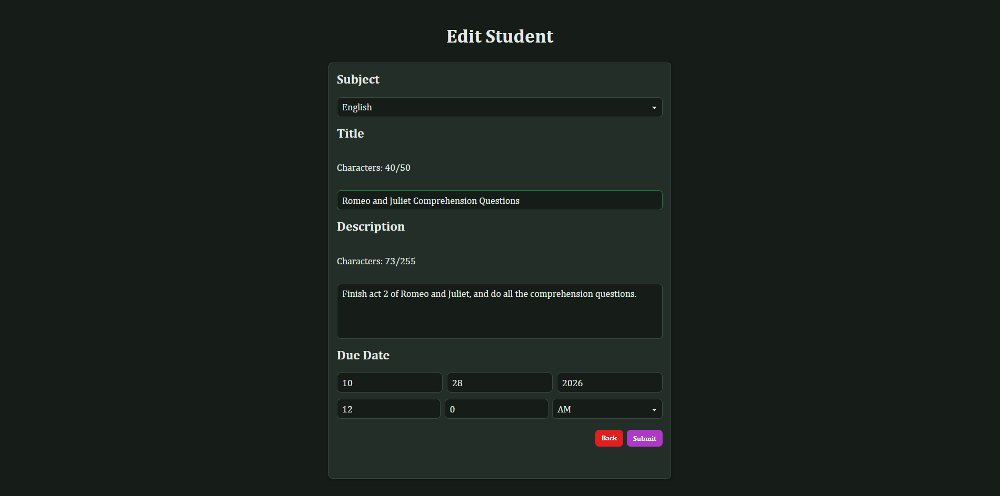

Assignment Manager

A web application that allows students to track assignments and deadlines

Features:
  - Create assignments
  - Edit assignments
  - View assignment dashboard
  - Delete assignments
  - Mark assignments complete
  - View overdue assignments

Technologies Used:
  - Python
  - Flask
  - HTML/CSS
  - JavaScript
  - SQLite

Future Improvements:
  - Email reminders
  - Calendar view
  - Priority levels

